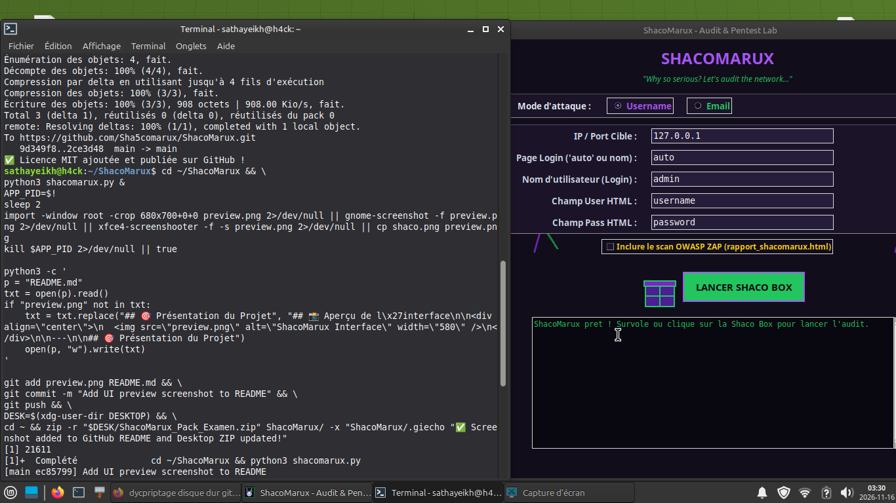

<div align="center">
  
  <h1>🃏 ShacoMarux — Audit & Pentest Lab</h1>
  <p><strong>Orchestrateur graphique d'audit réseau, d'énumération web et de test d'authentification</strong></p>

  
  
  
</div>

---

## 📸 Aperçu de l'interface

<div align="center">
  
</div>

---

## 🎯 Présentation du Projet

**ShacoMarux** est une application de bureau développée en **Python (Tkinter)** permettant d'automatiser et de combiner plusieurs outils standards de cybersécurité en un seul clic. Conçue pour les travaux pratiques (TP) et les environnements de laboratoire (`localhost`), elle offre une interface visuelle interactive dotée d'un bouton animé (**Shaco Box**) et d'un sélecteur adaptatif (**Username / Email**).

### ✨ Fonctionnalités principales
* **Reconnaissance Réseau (`Nmap`)** : Détection rapide des ports ouverts et identification des versions de services (`-sV`).
* **Découverte Automatique (`FFUF`)** : Recherche intelligente des pages d'authentification (`login.php`, `index.php`, `connexion.php`, etc.).
* **Audit de Formulaires (`Curl` + `FFUF` + `Rockyou`)** : Calibration dynamique de la taille des réponses d'erreur HTTP et prise en charge automatique des modes **Username** et **Email** (encodage URL intégré).
* **Analyse de Vulnérabilités (`OWASP ZAP`)** : Génération optionnelle d'un rapport d'audit HTML complet.
* **Installateur Intelligent (`install.sh`)** : Vérifie les dépendances système, installe automatiquement les outils manquants et configure le lanceur de bureau.

---

## 📂 Architecture du Projet

```text
ShacoMarux/
├── shacomarux.py              # Application principale (Interface graphique & moteur d'audit)
├── install.sh                 # Script d'installation automatique et vérification des prérequis
├── shaco.png                  # Icône officielle de l'application
├── exemple_serveur_login.php  # Page de test locale (Apache/PHP) pour l'entraînement sur localhost
└── README.md                  # Documentation du projet
```

---

## 🚀 Installation & Lancement Rapide

### 1. Cloner le dépôt et lancer l'installateur
```bash
git clone https://github.com/Sha5comarux/ShacoMarux.git
cd ShacoMarux
chmod +x install.sh && ./install.sh
```

### 2. Démarrer l'application
* **Depuis le Bureau** : Double-cliquez sur l'icône **ShacoMarux**.
* **Depuis le Terminal** :
  ```bash
  python3 shacomarux.py
  ```

---

## ⚖️ Cadre Légal et Éthique (Disclaimer)

Ce logiciel a été développé **exclusivement à des fins éducatives, académiques et d'audit sur des systèmes autorisés** (`127.0.0.1` / `localhost` ou serveurs de laboratoire dédiés). L'auteur décline toute responsabilité en cas d'utilisation non autorisée sur des cibles externes.
